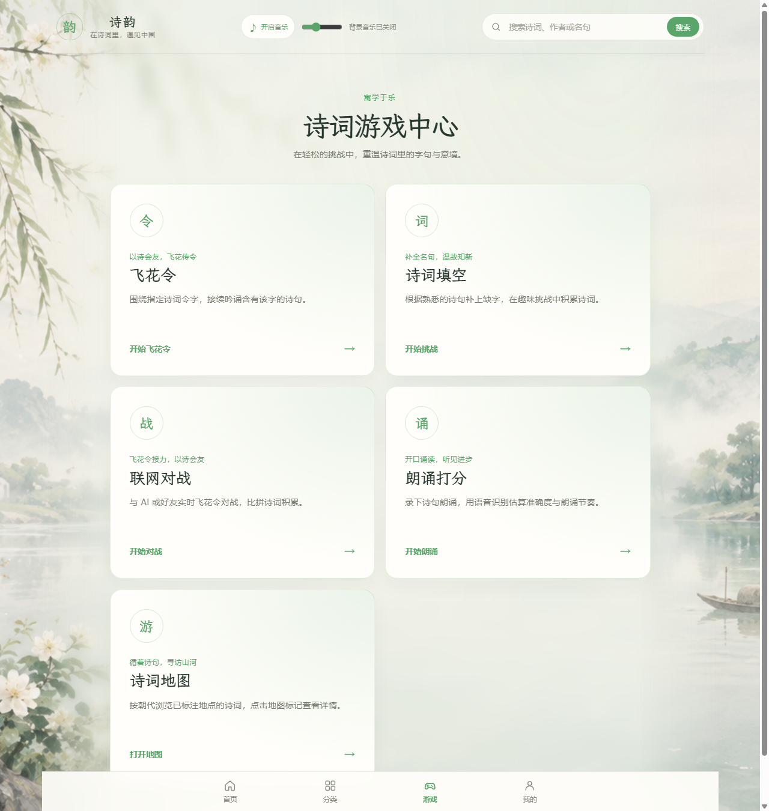
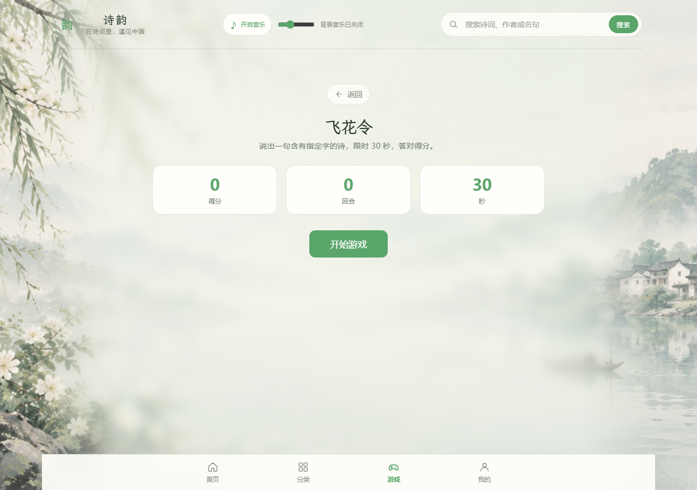
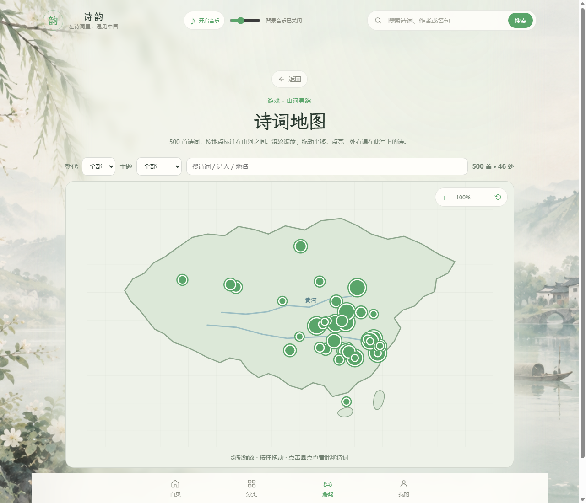

# 诗韵 · 古诗库

> 一座可以「听、读、玩、记」的古典诗词小馆 —— 在诗词里，遇见中国。

<p>
  
  
  
  
  
  
</p>


---

## 目录

- [项目简介](#项目简介)
- [功能全景](#功能全景)
- [界面预览](#界面预览)
- [技术亮点](#技术亮点)
- [技术栈](#技术栈)
- [快速开始](#快速开始)
- [目录结构](#目录结构)
- [项目数据](#项目数据)
- [团队分工](#团队分工)
- [迭代与协作规范](#迭代与协作规范)
- [文档索引](#文档索引)

---

## 项目简介

**诗韵 · 古诗库** 是一个面向古诗词爱好者的单页 Web 应用（Vue 3 课程项目，南开大学软件学院）。

它不只做「把诗摆出来」这件事：项目把 **500 首诗词、500 条整篇朗读音频、5 种互动玩法、一套学习闭环和四季视觉主题** 装进了一个手机优先的界面里，让「读诗」变成可以听、可以玩、可以复习、可以留下痕迹的日常动作。

- **数据规模**：500 首诗词，覆盖先秦至清 **14 个朝代 / 时期**，每首含译文、注释、创作背景、作品赏析、艺术赏析、意境解读
- **内容形态**：原文 + 朗读音频 + 标签 + 地理点位（部分作品），从「看」延伸到「听」和「去」
- **学习闭环**：玩游戏答错 → 自动进背诗卡 → 回炉复习 → 足迹与收藏沉淀
- **零后端依赖**：纯前端即可完整运行；联网对战为可选增强，未配置时自动降级

---

## 功能全景

### 一、诗词浏览与检索

| 模块 | 能力 |
|---|---|
| **首页** | 每日推荐、随机诗词卡片、搜索入口，一屏进入诗词世界 |
| **分类** | 朝代 / 体裁 / 主题三维组合筛选，实时显示命中数量（如「唐 · 130 首」），并按朝代分组浏览 |
| **搜索** | 标题、作者、名句全文检索，边输边筛 |
| **诗词详情** | 原文正字 + 作者朝代标签 + 收藏；折叠面板承载 **译文 / 注释 / 创作背景 / 作品赏析 / 艺术赏析 / 意境解读**（空字段不渲染） |
| **朗读** | 每首诗配一条整篇朗读音频，内置播放器支持暂停、进度拖动、音量 |
| **百科卡片** | 详情页可展开作者/词条百科卡片，补充背景知识 |
| **我的足迹** | 进入详情页即自动记录，按时间倒序回看读过哪些诗 |

### 二、诗词游戏中心（5 种玩法）

| 玩法 | 说明 | 技术实现 |
|---|---|---|
| **飞花令** | 围绕令字轮流接含该字的诗句，限时作答 | 诗句倒排索引 `getPoemsByContent(char)` + 计时器 |
| **诗词填空** | 名句挖空补全，即时判定对错 | 同字/整句比对 + 错题埋点 |
| **联网对战** | 飞花令接力对战，整局共用令字，接不上/超时/重复即负 | 统一状态机 + 三通道（AI / 跨标签页 / Supabase） |
| **朗诵打分** | 对着麦克风读诗，自动识别并打分 | MediaRecorder + Web Speech API + 双维度评分 |
| **诗词地图** | 选朝代，在地图上点亮诗人写作地 | 纯 SVG 中国轮廓 + 经纬度投影 |

### 三、学习闭环

- **背诗卡（我的学习）**：游戏里答错或超时的诗词自动入库，卡片形式展示「错了几次、错在哪种玩法」，点卡片直接回详情复习，可一键清空
- **我的收藏**：详情页收藏，集中复习
- **学习统计**：个人中心展示已收藏 / 已学诗词数量
- **对战战绩**：胜场负场本地留存，随时查看

### 四、个性化与氛围

- **四季主题**：春 / 夏 / 秋 / 冬四套水墨背景，一键切换
- **字体系统**：隶书、行楷等中文字族可选，字号三档（小 / 中 / 大）
- **背景音乐**：四季环境音乐 + 游戏音效，独立开关与音量，偏好持久化（默认关闭，不打扰）
- **玻璃拟态**：半透明卡片 + 背景虚化，让水墨背景成为界面的一部分
- **头像定制**：个人中心可自选头像样式

---

## 界面预览

### 首页与诗词详情

| 首页 · 推荐与搜索 | 诗词详情 · 朗读与赏析 |
|---|---|
|  |  |

### 分类与搜索

| 分类 · 三维筛选 | 搜索 |
|---|---|
|  |  |

### 游戏中心



| 飞花令 | 诗词填空 |
|---|---|
|  |  |

| 朗诵打分 | 诗词地图 |
|---|---|
|  |  |

### 对战与学习

| 联网对战 · 三种通道 | 我的学习 · 背诗卡 |
|---|---|
|  |  |

### 个人中心与设置

| 我的 | 个性化设置 |
|---|---|
|  |  |

---

## 技术亮点

### 1. 清晰的分层：数据 → 接入层 → 视图

```
src/data/poems/*.json   原始数据（5 个文件 × 100 首）
        ↓
src/api/poems.js        16 个纯函数查询接口（唯一出口）
        ↓
src/views/*.vue         页面只调 API，不碰 JSON
```

`src/api/poems.js` 提供 `getAllPoems` / `getPoemById` / `searchPoems` / `getPoemsByFilters` / `getPagedPoems` / `getRandomPoems` / `getPoemsByContent` / `getPoemAudio` 等接口，页面层完全不感知数据从哪来。好处是：数据换源（未来接后端接口）只改一个文件，视图零改动。

### 2. 状态层：8 个 Pinia Store + 统一持久化

| Store | 职责 | localStorage key |
|---|---|---|
| `user` | 登录态与昵称 | `shiyun-user` |
| `favorites` | 收藏列表 | `shiyun-favorites` |
| `mistakes` | 错题库（背诗卡数据） | `shiyun-mistakes` |
| `poemHistory` | 浏览足迹 | `shiyun-history` |
| `battle` | 对战状态机与战绩 | `shiyun-battle-record` |
| `recitation` | 朗诵评分记录（最多 100 条） | `shiyun-recitation-results` |
| `audio` | 背景音乐开关 / 音量 / 音效 | `shiyun-audio-*` |
| `display` | 主题 / 字体 / 字号 | `shiyun-display-*` |

所有 Store 的读写都包在 `try/catch` 里：隐私模式、配额写满、脏数据都不会让页面崩，只会退化成「本次不持久化」。

### 3. 朗诵打分：把「读出声」变成可量化反馈

```
麦克风 → MediaRecorder 录音 → Web Speech API 中文识别 → 文本归一化比对
                                                       ├─ 字句准确度（覆盖率）
                                                       └─ 节奏流畅度（字/秒估算）
```

- 录音需要安全上下文（HTTPS 或 localhost），不支持时给出明确提示而非白屏
- 识别文本 **允许手动修正**（口音、静音环境下的兜底），再点「评分」
- 低于阈值的朗读结果自动写入背诗卡，形成「读不好 → 去复习」的闭环

### 4. 诗词地图：不引入任何地图 SDK

- 中国轮廓、长江黄河、岛屿全部是**手绘 SVG 路径**，无第三方地图依赖（免 Key、免合规风险、可离线）
- 诗词自带 `location.longitude/latitude`，按经纬度**线性投影**到 SVG 视口
- 同坐标多首诗时，围绕中心点按角度**环形散开**，避免点位重叠
- 点击点位直接跳转诗词详情

### 5. 联网对战：一套状态机，三条通道

| 通道 | 场景 | 实现 |
|---|---|---|
| 🤖 AI 对战 | 单人演示 / 练习 | 本地生成对手出句 |
| 💻 同设备双开 | 演示真实实时 | `BroadcastChannel` 跨标签页同步 |
| 🌐 联网对战 | 跨设备真人对战 | Supabase Realtime（Broadcast） |

三者共用同一套状态机（大厅 → 匹配 → 对战 → 结算），切换通道不改业务逻辑。**未配置 Supabase 凭证时自动降级**为同设备双开并提示，保证「没有后端也能完整演示」。

```js
// 动态加载 SDK，未安装/未配置都不影响构建与运行
const pkg = '@supabase' + '/supabase-js'
const mod = await import(/* @vite-ignore */ pkg)
```

### 6. 路由体验：App 内返回栈

移动端 WebView 里「浏览器后退」经常直接退出应用。项目实现了 `goAppBack()`：

- 维护一份 App 内部访问栈（上限 50 条），返回时优先回「App 内上一页」
- 识别 `popstate`，用户用系统手势返回时同步修正栈
- 每个路由可配 `meta.backFallback`，栈空时落到合理兜底页
- 顺带在 `afterEach` 里完成「足迹自动记录」

### 7. 性能与健壮性

- **路由懒加载**：17 个路由全部 `() => import(...)`，首屏只加载必要 chunk
- **字体本地托管**：隶书 woff2、行楷 ttf 全部放 `public/fonts/`，不依赖外部 CDN
- **媒体分级加载**：500 条朗读音频按需请求，不预加载
- **空字段不渲染**：译文/注释等字段可能为空串，模板统一判空，避免出现空面板
- **插值渲染**：文本一律走 Vue 插值（等价 `textContent`），天然免疫 XSS

---

## 技术栈

| 层次 | 选型 |
|---|---|
| 框架 | Vue 3.5（`<script setup>` 组合式 API） |
| 构建 | Vite 8 + `@vitejs/plugin-vue` |
| 路由 | Vue Router 4（history 模式 + 懒加载 + 返回栈） |
| 状态 | Pinia 4（Setup Store 风格） |
| 浏览器 API | MediaRecorder、Web Speech API、BroadcastChannel、Web Audio |
| 可选后端 | Supabase（Realtime + 表结构见 `supabase/migrations`） |
| 样式 | 原生 CSS（CSS 变量做主题、Grid/Flex 布局、玻璃拟态） |
| 视觉资源 | 四季水墨背景、隶书/行楷字体、SVG 手绘地图 |

> 课程硬性要求：Vue 3 + Vite + Vue Router + Pinia，未引入任何 UI 组件库，全部手写。

---

## 快速开始

```bash
# 1. 安装依赖
npm install

# 2. 本地开发（默认 http://localhost:5173）
npm run dev

# 3. 生产构建（答辩硬指标，必须成功）
npm run build

# 4. 预览构建产物
npm run preview
```

### 可选：启用联网对战

```bash
cp .env.example .env
# 填入 VITE_SUPABASE_URL / VITE_SUPABASE_ANON_KEY
npm install @supabase/supabase-js
```

不配置也能玩：会自动降级为「同设备双开」（两个标签页实时对战）。

> 朗诵打分需要 **localhost 或 HTTPS**（麦克风权限要求安全上下文），并建议使用 Chrome / Edge。

---

## 目录结构

```
shiyun/
├─ index.html
├─ package.json
├─ vite.config.js              # @ → src 别名
├─ .env.example                # 联网对战配置模板
├─ public/
│  ├─ audio/                   # 500 条诗词朗读 + 四季音乐 + 游戏音效（507 个 mp3）
│  ├─ fonts/                   # 隶书 woff2 / 行楷 ttf（本地托管）
│  └─ images/themes/           # 春 / 夏 / 秋 / 冬 背景图
├─ src/
│  ├─ main.js                  # 挂载 Pinia + Router
│  ├─ App.vue                  # 开屏动画 + 全局布局
│  ├─ api/poems.js             # 数据接入层（16 个查询接口，唯一数据出口）
│  ├─ data/poems/              # 诗词数据：5 人各 100 首
│  │  ├─ hong.json  liu.json  chen.json  xu.json  zhang.json
│  │  └─ README.md             # 数据字段与投稿规范
│  ├─ router/index.js          # 17 条路由 + goAppBack 返回栈
│  ├─ stores/                  # 8 个 Pinia store（user / favorites / mistakes / battle / ...）
│  ├─ layout/AppLayout.vue     # 顶栏（搜索 + 音乐）、四季背景、底部导航
│  ├─ components/              # PoemCard / AudioPlayer / BaiduBaikeCard
│  ├─ styles/                  # theme.css（四季/字体变量）、lishu-font.css
│  └─ views/                   # 17 个页面
├─ supabase/
│  ├─ migrations/0001_battle.sql   # 对战房间表 + RLS + Realtime
│  └─ README.md
└─ docs/
   ├─ poem-schema.md           # 诗词字段规范
   ├─ screenshots/             # README 界面截图
   ├─ gen_audio.py             # 朗读音频生成脚本
   ├─ gen_audio_all.py         # 全量音频生成脚本
   └─ sprint*.md / *.json      # 各迭代规划、分工与任务清单
```

---

## 项目数据

| 指标 | 数量 |
|---|---|
| 诗词 | **500 首**（先秦 → 清，14 个朝代/时期） |
| 音频 | **507 个 mp3**（500 条整篇朗读 + 四季环境音乐 + 游戏音效） |
| 页面（views） | 17 个 |
| 路由 | 17 条（全部懒加载） |
| Pinia Store | 8 个 |
| Vue 组件文件 | 22 个 |
| 源码行数 | 约 7,900 行（`src/**/*.vue` + `*.js`） |
| 字体 | 隶书 woff2 分片 24 个 + 行楷 / 霞鹜文楷 ttf |

### 朝代分布（部分）

| 唐 | 宋 | 清 | 汉 | 元 | 东晋 | 五代 | 先秦 | 明 | 三国 |
|---|---|---|---|---|---|---|---|---|---|
| 130 | 126 | 34 | 30 | 26 | 23 | 22 | 22 | 21 | 21 |

---

## 团队分工

| 成员 | GitHub | 负责模块 | 主要产出 |
|---|---|---|---|
| **洪修睿** | [@Coder-YourAdm](https://github.com/Coder-YourAdm) | 项目负责人 · 核心逻辑 · 联调 | 项目骨架与协作规范；用户/收藏/错题/对战 Store；飞花令、诗词填空、**背诗卡（我的学习）**、**联网对战**；数据 ID 规范化；字体本地化；README |
| **徐潇** | [@xvxiao30509899](https://github.com/xvxiao30509899) | 数据层 | 100 首诗词数据；`api/poems.js` 全部查询接口；诗词 ID 规范；字段文档 `poem-schema.md`；分类导航、搜索 |
| **刘庭彰** | [@Akirachan86](https://github.com/Akirachan86) | 布局 · 组件 · 新玩法 | 100 首诗词数据；全局布局 `AppLayout`、`PoemCard`、诗词详情页、游戏中心；**朗诵打分**、**诗词地图**、**背景音乐** |
| **陈汝桐** | [@AriaaaCHEN](https://github.com/AriaaaCHEN) | 页面 · 路由 | 100 首诗词数据；路由表与返回栈；首页、搜索页、分类列表、个人中心等页面重构 |
| **张雅萱** | [@yaxuanzhang490-cloud](https://github.com/yaxuanzhang490-cloud) | 视觉 · 主题 · 素材 | 100 首诗词数据；四季主题与背景图、隶书/行楷字体、玻璃拟态、**头像定制**、**返回导航**、**浏览足迹**、朗读音频接入 |

> 诗词数据由 5 人各贡献 100 首，ID 采用 `朝代-负责人-序号` 规范（如 `tang-hong-0001`），从源头避免冲突。

---

## 迭代与协作规范

项目按 **Sprint** 推进，每个 Sprint 一次发版：

| 版本 | 内容 |
|---|---|
| **v0.1** | 骨架、分支规范、目录与公共约定 |
| **v0.2** | 首页 / 分类 / 详情 / 搜索 / 游戏 / 登录 / 我的，全链路可跑（Sprint 2） |
| **v0.3** | 500 首数据 + 朗读音频 + 背诗卡 + 联网对战 + 朗诵打分 + 诗词地图 + 背景音乐 + 主题与头像（Sprint 3） |

### 分支与提交

- `main` 受保护，**禁止直接 push**，需 PR + 至少 1 个 approving review
- 日常集成在 `develop`，功能分支 `feature/sprintX-<scope>`、修复分支 `fix/<scope>`
- 提交前缀：`feat:` / `fix:` / `docs:` / `style:` / `release:`
- 合入前自查：`npm run build` 必须成功、控制台无报错

---

## 文档索引

| 文档 | 内容 |
|---|---|
| [`docs/poem-schema.md`](docs/poem-schema.md) | 诗词字段定义、投稿与校验规范 |
| [`src/data/poems/README.md`](src/data/poems/README.md) | 数据文件说明与示例 |
| [`supabase/README.md`](supabase/README.md) | 联网对战后端启用步骤与表结构 |
| [`docs/sprint2-ai-spec.md`](docs/sprint2-ai-spec.md) | Sprint 2 详细规格 |
| [`docs/sprint2-roles.md`](docs/sprint2-roles.md) | Sprint 2 逐人分工手册 |
| [`docs/sprint2-tasks.json`](docs/sprint2-tasks.json) | Sprint 2 任务清单（机器可读） |
| [`docs/sprint2-gantt.html`](docs/sprint2-gantt.html) | Sprint 2 甘特图 |

---

<p align="center">
  <sub>诗韵 · 古诗库 —— 用前端把千年诗句重新点亮</sub><br>
  <sub>南开大学软件学院 · 2026</sub>
</p>
